# Edição de vídeo com IA, com humano no circuito

**English summary.** A programmatic video-editing engine for short talking-head videos, built as a Claude Code skill plus a Python/ffmpeg toolkit. Speech is transcribed with faster-whisper, every word is re-timed by forced phonetic alignment (torchaudio MMS_FA) so cuts never clip a word, an AI agent writes an edit decision list (EDL) that a human approves, and a deterministic renderer executes it. Quality gates then *measure the output* — re-aligning the expected words in the final audio, checking every splice for gaps, and pulling frames for visual review — before a person signs off. The same plan → approve → render → measure loop applies to training videos, webinar clips and marketing content at scale.

---

## O problema

Editar vídeo falado é trabalho repetitivo e caro: tirar silêncios, escolher a melhor tomada de cada frase, legendar, enquadrar, nivelar o áudio. Automatizar com "IA que edita" esbarra em três falhas que só aparecem quando alguém assiste:

- **Palavra decepada.** O Whisper reconhece bem o texto, mas marca mal o tempo: medido num take de 562 palavras, o erro mediano por borda foi de 0,25 s (p90 0,44 s, máximo 1,24 s), e ele fecha a palavra cedo. Todo corte feito com essa régua corta palavra.
- **Defeito que nenhum teste de texto vê.** Um número mutilado no áudio foi retranscrito como outro número plausível e passou na comparação de texto. Um trecho mudo com a mão do apresentador em quadro passou em todas as checagens de áudio.
- **Ninguém para aprovar.** Um pipeline que renderiza direto entrega rápido o que ninguém pediu.

## A solução

Um motor em que **a IA decide e explica, a máquina executa e mede, e uma pessoa aprova**:

1. **Ler** — `analisar.py` transcreve com faster-whisper (VAD, guardas contra alucinação).
2. **Medir** — `alinhar_fonetico.py` reposiciona cada palavra por alinhamento fonético forçado (MMS_FA). Essa é a régua de tempo de todo o resto.
3. **Decidir** — o montador (`melhor_de.py`) escolhe, frase a frase, a melhor execução entre vários takes; ou `cortar_silencio.py` faz o plano simples de pausas. A saída é um **plano legível** (EDL em JSON).
4. **Aprovar o plano** — o revisor vê trechos, durações, o que sai e por quê, antes de qualquer render.
5. **Executar** — `render_edl.py` é 100% mecânico: aplica o cutmap aprovado, reenquadra para 9:16, legenda, normaliza loudness e grava um relatório.
6. **Medir a saída** — portões independentes reprovam com exit 2 e lista de problemas: palavra decepada ou perdida, engasgo na emenda, repetição, palavra essencial ausente, legenda acesa no silêncio, legenda sobre o rosto, frames suspeitos para olhar.
7. **Aprovar a peça** — uma pessoa assiste ao staging e abre os frames; só então `pipeline_peca.py aprovar` promove o arquivo, com um carimbo auditável.

## Arquitetura

```mermaid
flowchart LR
    B[Brutos<br/>vários takes] --> A1[analisar.py<br/>faster-whisper<br/>texto por palavra]
    A1 --> A2[alinhar_fonetico.py<br/>MMS_FA<br/>tempo medido]
    R[Roteiro] --> M
    A2 --> M[Montador<br/>melhor_de.py / cortar_silencio.py<br/>agente de IA escreve o EDL]
    M --> P{{Plano legível<br/>trechos, durações,<br/>o que sai e por quê}}
    P -->|revisor aprova| RE[render_edl.py<br/>ffmpeg + NVENC<br/>mecânico e re-executável]
    P -->|revisor ajusta| M
    RE --> AC[Acabamento<br/>legenda ASS palavra ativa<br/>zoom suave · rosto YuNet<br/>música em nível medido]
    AC --> G[Portões medidos na saída<br/>checar_corte · checar_palavras<br/>cobertura da legenda<br/>auditoria de frames]
    G -->|exit 2: reprovada| M
    G -->|ok| S[Staging<br/>+ relatório dos portões]
    S --> H{{Pessoa assiste<br/>e abre os frames}}
    H -->|aprovar| F[Pasta final<br/>+ APROVADA.json<br/>hash do EDL, portões, revisor]
    H -->|recusar| M
```



Estrutura do repositório:

```
skill/SKILL.md            instruções do agente (Claude Code): fluxo, princípios, ferramentas
scripts/                  o motor (24 scripts, CLI única em video_ia.py)
  comum.py                ffmpeg com timeout e fallback NVENC->x264, cutmap, loudnorm, config
  analisar.py             transcrição word-level (faster-whisper)
  alinhar_fonetico.py     alinhamento forçado MMS_FA, saneamento de alucinação
  melhor_de.py            montador best-of entre takes (frase atômica, programação dinâmica)
  cortar_silencio.py      plano de corte de pausas
  render_edl.py           EDL -> vídeo vertical (schema no --help)
  pipeline_peca.py        plano -> montar (render + portões) -> aprovar (carimbo)
  checar_corte.py         portão: palavra decepada/perdida, engasgo, repetição
  checar_palavras.py      portão: o que não pode sumir / não pode entrar
  auditar_video.py        portão visual: frames de vãos sem fala e emendas
  gerar_ass.py            legendas ASS + portão de cobertura
  transicoes.py, rostos.py, checar_legenda_rosto.py, musica.py, capa.py, lote.py, ...
config/                   identidade visual neutra, pronúncias de siglas, palavras críticas
docs/licoes.md            ~140 lições de produção: cada uma é um defeito real medido
exemplos/demo_sintetica.py  demonstração ponta a ponta com dados sintéticos
```

## Técnicas de IA e engenharia

- **ASR + alinhamento forçado em camadas.** O faster-whisper fornece o texto; o MMS_FA (wav2vec2 CTC, token `<star>` para absorver áudio que o texto não explica) fornece o tempo. Números e siglas ganham hipóteses de pronúncia e vence a de melhor score. Spans fisicamente impossíveis são reinterpolados; áudio com energia de fala e sem palavra é retranscrito isolado e reinserido, para o montador enxergar repetições que o ASR colapsou.
- **Montagem best-of por programação dinâmica.** Cada frase do roteiro é procurada por janela deslizante em cada take; o custo combina cobertura, disfluência (falsa partida, gaguejo), improviso (quase grátis), truncamento de fim de frase e queda de nível de voz; trocar de take tem custo. Um estado "pular frase" garante que uma frase ruim não derrube a peça.
- **Bordas medidas por energia.** O fim da fala é onde o envelope de 10 ms fica 80 ms abaixo de 10% do nível local; a pausa entre frases é calibrada no ritmo do próprio falante (p75/p90), não num limiar fixo.
- **Agente como editor, scripts como ferramentas.** O `SKILL.md` instrui o agente a fazer o julgamento editorial (o que entra, o que sai, por quê) e a sempre mostrar o plano antes de renderizar; os scripts não tomam decisões editoriais escondidas.
- **Render determinístico.** EDL em JSON, segmentos quantizados na grade de quadros (sem travar vídeo na emenda), ffmpeg sempre como lista de argumentos com timeout, `-filter_complex_script` para grafos longos, NVENC com fallback automático, loudnorm em duas passadas, gravação atômica de manifest e cache.
- **Visão computacional para enquadrar.** YuNet (OpenCV) acha o rosto principal pela trilha mais persistente e ancora pela linha dos olhos; transições de zoom suave com recorte subpixel (`perspective`) no corte medido por detecção de cena.

## Controles de qualidade e governança

| Controle | O que garante |
|---|---|
| **Plano antes do render** | nada é renderizado sem um plano legível aprovado por uma pessoa |
| **Separação de papéis** | quem decide a borda (montador) não é quem a executa (render) nem quem a confere (portões) |
| **Portões que medem a saída** | `checar_corte` alinha o texto esperado no áudio final e compara o span de cada palavra com o do bruto; mede o vão em cada emenda contra o ritmo do falante |
| **Portão de transcrição** | `checar_palavras` parte do roteiro: números e nomes que não podem sumir, trechos proibidos (erro de fato) que não podem entrar |
| **Portão de legenda** | cada palavra com exatamente um evento ativo; nenhuma legenda acesa no silêncio; legenda fora do rosto |
| **Auditoria visual** | frames de vãos sem fala com movimento, de emendas com salto e das pontas — a medição diz onde olhar; a pessoa olha |
| **Exit codes honestos** | 0 aprovada, 2 reprovada (com lista e medições), 1 o portão quebrou — quebra nunca vira reprovação nem aprovação |
| **Staging + carimbo** | o arquivo só vai para a pasta final por `aprovar`, com hash do EDL e do vídeo, versão dos portões e nome do revisor |
| **Override declarado** | aprovar com portão pendente exige `--override "motivo"`, gravado no carimbo |
| **Versão dos portões** | mudou uma regra de portão, as aprovações antigas caducam |
| **Lote idempotente** | manifest por vídeo, retomada sem reprocessar, EDL escrito à mão nunca sobrescrito |

## Como rodar

Requisitos: `ffmpeg` com libass (build "full"), Python 3.10+.

```bash
pip install -r requirements.txt          # faster-whisper, torch/torchaudio, opencv, ...
cp .env.example .env                      # opcional: caminhos de fontes, modelo, identidade

# demonstração ponta a ponta, sem modelos pesados nem mídia real (~1 min)
python exemplos/demo_sintetica.py --manter

# fluxo real, um vídeo
python scripts/video_ia.py analisar bruto.mp4 --saida trabalho/bruto
python scripts/video_ia.py alinhar trabalho/bruto
python scripts/video_ia.py cortar-silencio trabalho/bruto          # imprime o PLANO
# ... revisor aprova; escreva o EDL (exemplos/edl_exemplo.json) ...
python scripts/video_ia.py render edl.json --qualidade preview

# fluxo real, roteiro + vários takes
python scripts/video_ia.py melhor-de roteiro.txt trabalho/take1 trabalho/take2 --saida c.json
python scripts/video_ia.py peca plano   --casamento c.json
python scripts/video_ia.py peca montar  --casamento c.json --roteiro roteiro.txt \
       --nome peca01 --trabalho trabalho --legenda karaoke
python scripts/video_ia.py peca aprovar --trabalho trabalho --nome peca01 \
       --final final --revisor "Nome de quem assistiu"
```

Fontes, o modelo YuNet e os pesos do MMS_FA/Whisper **não vêm no repositório**: veja `fonts/README.md` e `models/README.md` (o MMS_FA e o Whisper baixam sozinhos no primeiro uso).

A demonstração gera um vídeo 16:9 sintético (testsrc2) cuja "fala" são pulsos de tom com tempos conhecidos, e então roda plano → aprovação → render 9:16 com legenda karaokê → conferência medida → transição → música → auditoria → pipeline com aprovação recusada sem os portões de áudio e aceita com override declarado. Ela confere 13 propriedades da saída (duração prevista × real, nenhuma palavra decepada pela energia no miolo de cada palavra remapeada, pausa morta removida, cobertura exata da legenda, destaque queimado no frame, cama musical no alvo, carimbo gerado). Os vídeos ficam numa pasta temporária, nunca no repositório.

## Resultados

Números medidos em produção (vídeos curtos de um apresentador, publicados em redes sociais):

- **Primeiro uso em produção:** 11 vídeos montados a partir de 24 brutos, cerca de 55 minutos de fala. A versão que cortava com os tempos do Whisper teve **três entregas seguidas reprovadas** na revisão humana (repetição, palavra decepada, engasgo, número mutilado).
- **Depois da troca de instrumento** (alinhamento fonético + portão que mede a saída): uma peça validada com **429 de 429 palavras íntegras medidas na saída e 7 emendas limpas**; um número de três dígitos que saía com 0,40 s (mutilado) passou a sair com **1,14 s**, inteiro.
- **Loudness** medido no resultado: **−14,1 LUFS / −0,94 dBTP** (alvo −14 / −1).
- **Casamento roteiro × fala** com linhas parafraseadas: scores de 80 a 96; uma linha que não foi gravada foi corretamente rejeitada (42,9 < 60).
- **Revisão adversarial do pipeline** (agente revisor + testes de função pura): 12 defeitos latentes confirmados e corrigidos antes de virarem defeito em entrega.
- **Auditoria visual:** os dois trechos sem fala apontados na revisão humana mediram movimento 24,4 e 24,3 — os maiores da peça, bem acima do limiar de 6.
- **Demonstração sintética deste repositório:** 13/13 verificações em cerca de 50 s numa máquina com GPU.

## Limitações

- Feito e medido para **fala em português**, um apresentador, formato vertical; outros idiomas exigem trocar o idioma do Whisper e o dicionário de pronúncias.
- O alinhamento fonético e a retranscrição pedem GPU para lotes grandes (rodam em CPU, mais devagar).
- **Licença dos pesos:** os pesos do MMS_FA são publicados para uso não comercial; para uso comercial, confira os termos ou troque o alinhador (ele está isolado numa função, `alinhar_fonetico.alinhar()`). Detalhes em `models/README.md`.
- Os limiares foram calibrados em gravações reais de um setup; `calibrar_fa.py` mede o viés do alinhador para um setup novo, mas outros limiares (movimento, salto visual) podem precisar de ajuste.
- A auditoria visual **aponta onde olhar**, não decide; continua exigindo uma pessoa.
- A camada de identidade visual aqui é básica (capa, end card, faixa, barra de progresso, legenda); identidades animadas mais ricas ficam fora deste repositório.
- Recorte de fundo de fotos (rembg) e títulos animados com marca ficaram fora do motor genérico.

## O que isso mostra para uma empresa

O padrão é **IA que propõe, máquina que executa, medição que confere e pessoa que aprova** — com rastro de quem aprovou o quê. Ele se transfere quase sem mudança para:

- **Treinamento e onboarding:** gravar uma vez, sem roteiro decorado; o montador escolhe a melhor execução de cada frase entre várias tentativas, tira hesitações e entrega módulos curtos com legenda — e o portão garante que nenhum passo do procedimento (número, nome de sistema) sumiu no corte.
- **Cortes de webinar, live e reunião gravada:** transcrição + seleção editorial por trecho, bordas medidas para não decepar fala, um plano revisável antes de gastar render, lote com retomada para dezenas de cortes.
- **Marketing em escala:** a mesma peça em várias versões (duração, legenda, chamada final), identidade visual por configuração, loudness e formato padronizados por plataforma, aprovação registrada antes de publicar.
- **Qualquer automação de backoffice com IA:** o desenho de "plano legível → aprovação → execução determinística → portão que mede o resultado → carimbo auditável" é o mesmo para conciliação, atendimento ou geração de documentos. A lição central de `docs/licoes.md` vale fora do vídeo: **conferir o texto não é conferir o resultado** — o controle tem de medir o produto final com um instrumento diferente do que o produziu.

## Licença

MIT — ver `LICENSE`. Código e documentação: Copyright (c) 2026 Luis Lelis.
